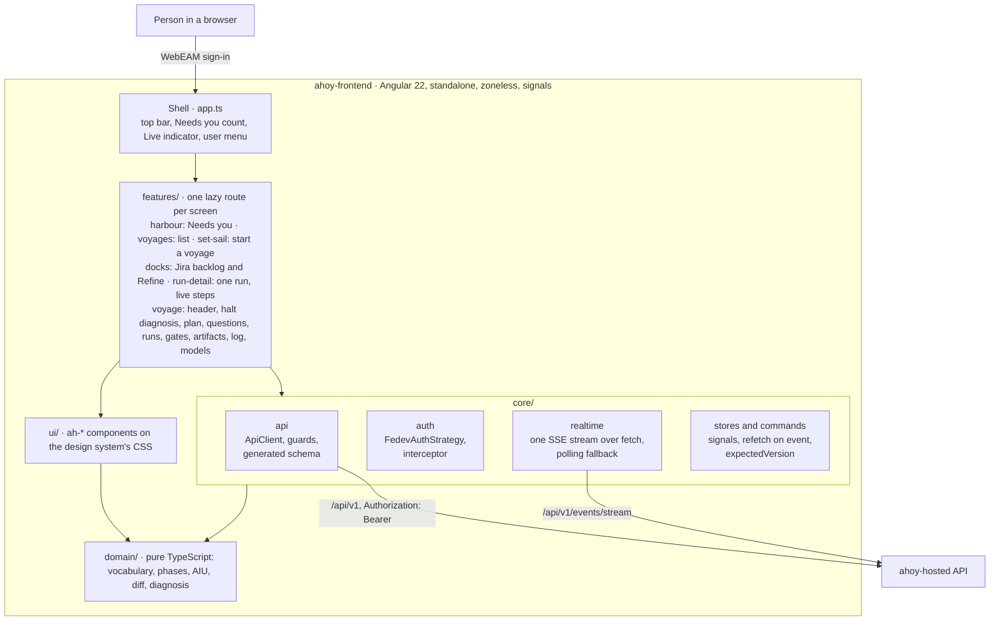

# Ahoy frontend · architecture

The technical decisions of the Angular 22 front end, as decided and as phase 0 confirmed them against the installed
packages. The original implementation plan (`docs/plan/`, lanes and waves) was removed on 2026-10-20: its architecture
rules (§5) and its approved dependencies (§10) now live here, and the rest is in git history
(`git show b1f9b88:docs/plan/00-overview.md`). Reviewed against the code on 2026-10-11 (WebEAM sign-in, the company
template's tooling, the Jira backlog, refinements and diagnoses) and, for §5, on 2026-10-20. The system around it is in
`ahoy-hosted/docs/architecture.md`.

## The app at a glance



- Screens read shared state from the signal stores in `core/stores` and send story commands through
  `core/commands` (`CommandRunner`: conflicts, double clicks, `expectedVersion`). Reads that belong to one screen (the
  backlog, refinements, diagnoses, the plan document, run detail) call `ApiClient` from the feature.
- One event stream for the whole app; an event marks a resource stale and it is read again (F5, F6).
- Everything the API returns is `unknown` until a guard in `core/api` accepts it (F7); agent text is shown only through
  `ah-markdown` (F12).

## Decisions F1–F16

| #   | Decision                                                                                                                                           | Status in phase 0                                                                                                                                                                                                                                                  |
| --- | -------------------------------------------------------------------------------------------------------------------------------------------------- | ------------------------------------------------------------------------------------------------------------------------------------------------------------------------------------------------------------------------------------------------------------------ |
| F1  | Angular 22.2.x, standalone, `@angular/build`, zoneless with signals. Node `^22.22.3 \|\| ^24.15.0 \|\| >=26`, TypeScript `>=6.0 <6.1`.             | **Confirmed**: Angular 22.2.1, TypeScript 6.0.3, zoneless and OnPush are defaults (see below).                                                                                                                                                                     |
| F2  | No UI library. The design system's CSS (`tokens.css` + `bundle.css`) with thin Angular wrappers; `@angular/cdk` only for Dialog, overlay and a11y. | Decided; lane 1A/1C.                                                                                                                                                                                                                                               |
| F3  | Lazy routes per feature; the URL is the state (status filter, tab, Set sail query).                                                                | **Done**: every route of §5.3 is lazy, with a placeholder.                                                                                                                                                                                                         |
| F4  | State in signals and services. No NgRx.                                                                                                            | Decided; lane 2B.                                                                                                                                                                                                                                                  |
| F5  | Refetch on event, not local patching (300 ms debounce). Every command sends `expectedVersion`.                                                     | Decided; lanes 2B, 4A.                                                                                                                                                                                                                                             |
| F6  | One global SSE stream read with `fetch` (not `EventSource`), `Last-Event-ID` on reconnect, polling fallback.                                       | `FETCH` token created; lane 2B. Proxy streams SSE unbuffered (verified against a stub only).                                                                                                                                                                       |
| F7  | Types generated from the vendored OpenAPI + hand-written guards at the boundary; errors as values (`ApiResult`).                                   | Decided; lane 2A.                                                                                                                                                                                                                                                  |
| F8  | WebEAM sign-in through `@acme-fedev/auth`; `AuthStrategy` is the seam. `X-Ahoy-Actor` only in the dev-server proxy, for a local API.                | **Done** 2026-10-08: `FedevAuthStrategy` sends the bearer token (see below). Since 2026-10-12 only allowed qnumbers get past the shell: `allowedQnumbers` in `/config.json` (optional) or the API's `403 forbidden` shows "Access denied". SSO not proven on TEST. |
| F9  | Same origin: the app always calls the relative `/api/v1`.                                                                                          | **Done**: `API_BASE` = `/api/v1`; dev proxy forwards it.                                                                                                                                                                                                           |
| F10 | Typed Reactive Forms.                                                                                                                              | Decided; lanes 3B, 4A–4D.                                                                                                                                                                                                                                          |
| F11 | Vitest (the Angular CLI runner via `@angular/build`) for unit and component tests; Playwright for e2e.                                             | **Confirmed**: `ng test` runs Vitest 5.0.3 with jsdom 30.1.2. Playwright is lane 6C.                                                                                                                                                                               |
| F12 | Markdown with `marked` → `[innerHTML]`, sanitised by Angular. No `bypassSecurityTrust*`; raw HTML and images off.                                  | Decided; lane 1C.                                                                                                                                                                                                                                                  |
| F13 | Client-side diff (`diff`, jsdiff) to compare artifact revisions.                                                                                   | Decided; lanes 2C, 5C.                                                                                                                                                                                                                                             |
| F14 | AIU as integer nano-AIU; parse and format without floats (`domain/aiu`).                                                                           | Decided; lane 2C.                                                                                                                                                                                                                                                  |
| F15 | UI text in English, like the design system. No i18n framework for now.                                                                             | Decided.                                                                                                                                                                                                                                                           |
| F16 | Light theme by default, dark via `data-theme="dark"` on `<html>`. No visible toggle yet.                                                           | Decided; lane 1A.                                                                                                                                                                                                                                                  |
| F17 | One image for every team: the WebEAM realm and client, the Jira link and the allowed users come from `/config.json`.                               | Decided 2026-10-30 (Helm chart); see "Runtime configuration".                                                                                                                                                                                                      |

## What phase 0 confirmed (tasks 0.2 and 0.3)

Checked against `ng new --help` (CLI 22.2.1) and the typings in `node_modules/@angular/core` on 2026-10-06.

- **Scaffold.** `ng new ahoy-frontend --routing --style=scss --ssr=false --skip-git --package-manager=npm --zoneless
--test-runner=vitest --prefix=ah --standalone --strict --ai-config=none`, generated in a temporary folder and moved
  in. The CLI's file-name style guide is `2025` (`app.ts`, not `app.component.ts`); we keep it.
- **Zoneless is the default** since Angular 21 (`provideZonelessChangeDetection` docs: "Zoneless is enabled by default in
  Angular v21+"). There is no `zone.js` dependency and no provider in `app.config.ts`. Never add
  `provideZoneChangeDetection`.
- **OnPush is the default** in Angular 22: `ChangeDetectionStrategy.OnPush = 0`, and the old `Default` is now a deprecated
  alias of the new `Eager`. ESLint's `prefer-on-push-component-change-detection` (angular-eslint 22.5) forbids opting out;
  writing `changeDetection: ChangeDetectionStrategy.OnPush` explicitly is allowed (the phase 1 rule asks for it) but
  redundant.
- **Standalone is the default**; components omit `standalone: true`.
- **TypeScript 6.0.3**, pinned `~6.0.3`. The npm `latest` is 7.0.2, which `@angular/build` 22.2.1 rejects
  (`typescript: ">=6.0 <6.1"`); `typescript-eslint` 8.71.1 also needs `<6.1.0`. `~` keeps upgrades inside 6.0.x.
- **TypeScript flags.** `tsconfig.json` sets `strict`, `noUncheckedIndexedAccess`, `exactOptionalPropertyTypes`,
  `noImplicitOverride`, `noImplicitReturns`, `noFallthroughCasesInSwitch`, `verbatimModuleSyntax`, plus the scaffold's
  `noPropertyAccessFromIndexSignature` (kept: stricter) and the Angular `strictTemplates`, `strictInjectionParameters`,
  `strictInputAccessModifiers`. **No flag clashed with Angular's types**: the scaffold, the router, `HttpClient` and the
  tests compile with all of them. Each flag was proven by a throw-away file that `tsc` rejected (see `docs/progress.md`).
- **Modules.** `"module": "preserve"` with `"moduleResolution": "bundler"` (the CLI default). Relative imports have no
  extension. Cross-layer imports use the aliases `@domain/*`, `@core/*`, `@ui/*`, `@features/*`, `@testing/*`
  (`paths` without `baseUrl`, which TypeScript 6 deprecates). `package.json` has `"type": "module"`, so the `.js`/`.mjs`
  tool files are ES modules.
- **Typecheck.** `npm run typecheck` runs `tsc --noEmit` on `tsconfig.app.json` and `tsconfig.spec.json`, then
  `scripts/check-boundaries.mjs`. `tsc` does not check templates; `ng build` does (`strictTemplates`).
- **Tests.** `@angular/build:unit-test` with the Vitest runner and jsdom, `tsconfig.spec.json` (types `vitest/globals`).
  `npm test` = `ng test --watch=false`. Specs live next to the code; helpers live in `src/testing/`.
- **Root element.** `<ah-root class="ah">`, not the plan's `<app-root class="ah">`: the component prefix is `ah` and
  ESLint enforces it. The `ah` class is the design system's scope.

## 5. Architecture rules

These were §5 of the original plan, and code comments still cite them as "plan §5.x".

### 5.1 Layers and folders

```
src/
  styles.scss, styles/      tokens.css (generated), the design system's bundle, base styles
  environments/             one file per build configuration
  testing/                  fixtures/, mock-backend/ (dev and tests only, never in a production import)
  app/
    domain/                 pure TypeScript: types, vocabulary, phases, AIU, time, halt texts
    core/
      api/                  ApiClient, ApiError, guards, schema.d.ts (generated, never edited by hand)
      auth/                 AuthStrategy, FedevAuthStrategy, CurrentUser, access control
      config/               AppConfig (config.json at runtime)
      realtime/             event stream client, event bus, polling fallback
      stores/               StoriesStore, StoryStore, RunProgressBuffer
      commands/             CommandRunner (conflicts, double submits)
      mock/                 the mock API (may import src/testing/)
    ui/                     the design system in Angular (ah-* selectors), no API
    features/               harbour, voyages, set-sail, docks, voyage, run-detail, metrics, meetings
```

### 5.2 Boundaries

`scripts/check-boundaries.mjs` (part of `npm run typecheck`) enforces them:

- `domain/` imports only `domain/`: no Angular, rxjs, `node:`, `core`, `ui`, `features` or `testing`.
- `ui/` imports `domain/`, `ui/`, Angular and third-party packages; never `core`, `features` or `testing`.
- `core/` imports `domain/`, `core/` and Angular; never `ui` or `features`. `core/mock/` (lane 2D) may import
  `src/testing/`.
- `features/<x>/` import `domain`, `ui` and `core`; never another feature, nor the app root or environment files.
- Production code (anything but `*.spec.ts` and `src/testing/`) never imports `src/testing/`. The one exception was
  `src/environments/environment.mock.ts` (lane 2D); the company template no longer has it, so the `mock` configuration
  replaces no file and the in-browser mock backend is not wired in (see `docs/progress.md`).
- The composition root (`src/main.ts`, `src/app/app*.ts`) and `src/environments/` may import any layer.
- Aliases `@domain/*`, `@core/*`, `@ui/*`, `@features/*`, `@testing/*`; no top-level barrels.

### 5.3 Routes

`/` (All hands), `/voyages` (list, `?status=` and `?q=`), `/voyages/new` (Set sail, `?key=` and `?title=`), `/docks`
(the Jira backlog), `/meetings`, `/metrics`, `/voyages/:key` with the tabs `plan`, `questions`, `packages`, `runs`,
`gates`, `artifacts`, `log` and `models`, and `/voyages/:key/runs/:runId` (run detail). The URL is the state (F3). A
voyage opens on the tab `features/voyage/context/default-tab.ts` picks from the story's status.

### 5.4 Data flow

One global event stream (F6) feeds an event bus; the stores mark what an event touches as stale and read it again,
debounced 300 ms (F5), and features read the stores' signals.

- **Lists and the inbox.** `StoriesStore` pages through every story (`limit=500` until `nextCursor` is `null`) and stays
  current through events. The counts and the "Needs you" inbox (`awaiting_input`, `awaiting_decision`, `halted`) come
  from it.
- **A voyage.** `StoryStore.for(key)` exposes `story`, `state`, `runs`, `questions`, `gates`, `models`, `artifacts` and
  `events` as resources (`loading | ready | error`, `refresh()`); only the ones something observes stay alive.
- **`run.progress`** never triggers a refetch: it goes to `RunProgressBuffer` (deduplicated by `line`, with `omitted`
  and the last `spend`).
- Event types the app does not know are ignored: the contract allows new ones.

### 5.5 Commands, conflicts and errors

Every command is a `POST` with `expectedVersion`, the story version the person saw. `CommandRunner` turns every answer
into a value, and the UI treats them the same way everywhere:

| Answer                                                            | What the person sees                                                                      |
| ----------------------------------------------------------------- | ----------------------------------------------------------------------------------------- |
| `202` / `201`                                                     | The returned story becomes the truth; a past-tense toast ("Answer to Q2 sent.").          |
| `409 stale_version`                                               | "This voyage changed since you opened it": refresh, keep what was typed, allow a resend.  |
| `409 decision_already_recorded`                                   | Who decided first; "Your send-back wasn't recorded", the text kept, "Copy my text".       |
| `409 already_answered`                                            | The first answer, with the person's own text still visible.                               |
| `409 invalid_state` / `revision_ceiling_reached` / `legacy_story` | An error banner with the `detail` in plain words and the code on a technical line.        |
| `409 story_exists`                                                | An error on the key field, linking to the existing voyage.                                |
| `400 validation_failed`                                           | Errors beside the fields (`errors[].path`, `aria-invalid`).                               |
| `404 not_found`                                                   | "This voyage doesn't exist".                                                              |
| `401 unauthenticated`                                             | "Sign-in needed".                                                                         |
| `503 unavailable`, network failure                                | "Lost contact with the harbour", "Try again", `status · code · request id`.               |
| An answer of an unexpected shape                                  | `invalid_response`, "Ahoy sent something unexpected": a tooling failure, never a verdict. |

### 5.6 AIU, time and identity

- **AIU** is integer nano-AIU (`Number.isSafeInteger`, F14): one decimal in lists, two in the run detail (`domain/aiu`).
  A typed budget is parsed from its decimal text into integers, never through a float.
- **Time** is relative in lists ("22 m ago") and absolute in logs ("Tue 09:48").
- **Identity.** The API has no `GET /me`: `CurrentUser` reads `actor` from the `AppConfig`, which must match the actor the
  API sees. `AuthStrategy` is the seam for sign-in: the app config provides `FedevAuthStrategy`, which sends
  `Authorization: Bearer` with the WebEAM token (F8); `NoAuthStrategy`, which adds nothing, is the default for tests.

### 5.7 Untrusted content

Plans, snapshots, questions, agent messages and worker logs come from agents. They are shown only through
`ah-markdown` (F12): never `innerHTML` elsewhere, never `bypassSecurityTrust*`. `[REDACTED]` arrives masked by the API
and is shown as it is; markdown links open with `rel="noopener noreferrer"` and remote images are not loaded.

## Approved dependencies

Approved by the user on 2026-10-06. Runtime dependencies are pinned exactly and dev dependencies use `^` (TypeScript
`~6.0.x`). Any package outside this list needs a new approval.

| Package                                                                                   | Kind        | What for                                |
| ----------------------------------------------------------------------------------------- | ----------- | --------------------------------------- |
| `@angular/*` 22.2.x, `rxjs` 7.x, `tslib`, `typescript` 6.0.x, `@angular/cli` and `/build` | runtime/dev | Angular 22                              |
| `vitest` 5.x and the DOM environment the builder needs                                    | dev         | Unit and component tests (F11)          |
| `angular-eslint`, `eslint`, `typescript-eslint`                                           | dev         | Lint with the CLAUDE.md rules           |
| `prettier`, `husky`, `lint-staged`                                                        | dev         | Formatting and pre-commit               |
| `@angular/cdk` 22.x                                                                       | runtime     | Dialog, overlay, a11y (F2)              |
| `marked` 18.1.0                                                                           | runtime     | Markdown of plans and artifacts (F12)   |
| `diff` 9.0.0                                                                              | runtime     | Artifact revision diffs (F13)           |
| `openapi-typescript` 7.13.0                                                               | dev         | Types from `ahoy-v1.yaml`               |
| `ajv`, `yaml`                                                                             | dev         | Contract tests of fixtures and the mock |
| `@playwright/test`, `@axe-core/playwright`                                                | dev         | e2e and accessibility                   |

The company template (2026-10-08) added `@acme-fedev/auth` (WebEAM sign-in, F8) and `@acme-fedev/playwright-helpers`
from the company's private registry, plus its own tooling (`stylelint`, `stylelint-config-sass-guidelines`,
`@vitest/coverage-v8`). Without access to that registry, `npm ci` fails, so neither GitHub-hosted CI nor a cloud
session can build this app.

## Routing (task 0.7)

- `app.routes.ts` has one lazy `loadChildren` per feature. Order matters: `voyages/new` and
  `voyages/:key/runs/:runId` come before `voyages/:key`, and `voyages/:key` before `voyages`. Lanes never edit it.
- `voyages/:key` loads `features/voyage/voyage.routes.ts` (lane 4A): a `VoyageShell` with a `<router-outlet>` and one
  lazy `loadChildren` per tab (`tabs/<tab>/<tab>.routes.ts`, one lane each). Until 4A, the shell redirects to `plan`.
- The run detail is a top-level route owned by `features/run-detail/` (lane 5A), outside the voyage shell.
- Placeholders are `ah-placeholder` (`src/app/ui/placeholder/`), fed by route `data` (`heading`, `lane`) through
  `withComponentInputBinding()`. Each lane replaces its own; lane 6A deletes the component when nothing uses it.
- `**` shows a "Not found" placeholder (lane 6A). This is an addition to §5.3.
- **Dev-only routes** (`/_kit`) come from `environment.devRoutes`. Today `environment.ts` (the default, named `DEV`)
  adds `_kit` and `environment.test.ts` (the `test` configuration) has none. The `production` configuration replaces no
  file, so a production build uses `environment.ts` and carries `/_kit`; check which configuration the release builds.
- Each route sets its `title` (`<Name> · Ahoy`) through the router's default `TitleStrategy`.

## Application config (task 0.7)

`app.config.ts` provides `provideFedevAuth({ env, includeAccessTokenInBackendRequests: true })` with its initializer,
`AUTH_STRATEGY` (`FedevAuthStrategy`), `provideAppInitializer(initAppConfig)` (`core/config/app-config.ts`),
`provideRouter(routes, withComponentInputBinding())`, `provideHttpClient(withFetch(), withInterceptors([authInterceptor]))`
and `FETCH` (`globalThis.fetch`, `core/realtime/fetch.ts`). `API_BASE` (`core/api/api-base.ts`) comes from
`AppConfig.apiBase` (`/config.json`, `/api/v1` when there is none). `HttpClient` requests carry `Authorization: Bearer <WebEAM token>`; the event stream reads `fetch` directly, so
it takes the same token from `AUTH_STRATEGY`. Without a token the API answers `401 unauthenticated`.

## Runtime configuration (F17)

One image serves every team: whatever serves the app provides `/config.json` (the Helm chart mounts it from a ConfigMap
into the nginx root, which serves it with `Cache-Control: no-store`; when it is missing, the server-wide `error_page`
answers with `index.html` and status 404, which the app treats as no file). Every field is optional; a missing one
takes the build's value, and so does an invalid one outside `auth`, with a warning in the console.

```json
{
  "apiBase": "/api/v1",
  "auth": {
    "realmUrl": "https://sso.example.com/auth/oauth2/realms/root/realms/alpha",
    "clientId": "<the team's WebEAM client for the front end>",
    "scope": "openid profile email groups",
    "redirectUri": "https://ahoy.example.com/",
    "postLogoutRedirectUri": "https://ahoy.example.com/",
    "silentRefreshRedirectUri": "https://ahoy.example.com/ui/oauth/silent-refresh.html",
    "debug": false
  },
  "jiraBaseUrl": "https://jira.example.com/jira",
  "allowedQnumbers": ["q123456"]
}
```

`main.ts` reads the file once before bootstrap (`core/config/runtime-environment.ts`), because `provideFedevAuth` takes
its settings when it is provided, and hands the document to `initAppConfig` (`PRELOADED_APP_CONFIG`), which reads the
rest without fetching it again.

- Every WebEAM endpoint follows from `realmUrl` (`domain/auth-settings.ts`).
- The redirects default to the page's origin: `<origin>/` after sign-in and sign-out, and
  `<origin>/ui/oauth/silent-refresh.html`. WebEAM compares them character for character with the client's registered
  ones, so a team whose client registered others sets them in `auth`, kept exactly as written. FIO's TEST build today
  uses a host with a trailing slash, so its silent-refresh URI is `<origin>//ui/oauth/silent-refresh.html`: check the
  registration before FIO moves to `/config.json`.
- The auth library's debug logging is off unless `auth.debug` is `true`. `skipIssuerCheck` stays on, from the build,
  because WebEAM's token issuer is not the realm URL.
- An `auth` that is present but invalid stops the app: `main.ts` shows the problems instead of signing in against the
  build's realm.
- Without `auth` the build's environment signs in, as local builds do; the TEST build's `environment.test.ts` keeps
  FIO's realm and client only until its deployment serves `/config.json`.
- Without `jiraBaseUrl` the Backlog shows no Jira link.

## Dev server and proxy (task 0.6)

`npm start` = `ng serve`, whose `proxyConfig` is `src/proxy.conf.json` (`angular.json`). It forwards `/api` to
`http://127.0.0.1:8080` with `X-Ahoy-Actor: dev-user`, and the WebEAM paths (`/auth/oauth2/realms/root/realms/alpha`)
to the SSO host. `proxy.conf.mjs` (with `AHOY_API_TARGET` and `AHOY_ACTOR`) is no longer read by `ng serve`. The app
itself sends `Authorization: Bearer` when a WebEAM session exists (see "Application config").

- `AHOY_AUTH=dev` (which makes the API trust `X-Ahoy-Actor`) is for a local API only. The proxy is part of `ng serve`
  and never reaches production, where the Ingress routes `/api/v1` and real authentication applies.
- Only a local API started with `npm run dev -- --simulate` (0 AIU). **Never** `--live`, never the TEST environment.
- There is no `start:mock` script any more; `ng serve --configuration mock` builds without the mock backend (see
  §5.2).
- `npm run start:test` explicitly serves the `test` configuration with `src/proxy.conf.test.json`, forwarding the
  browser's API calls to the TEST API. Do not use it for automated validation or mutating actions without approval.

## Tooling (tasks 0.4, 0.5, 0.8)

The company template (2026-10-08) brought its own tool files beside the original ones. Where both exist, the tool reads
the template's first:

- **Prettier**: `.prettierrc` (single quotes, `trailingComma: es5`, the default 80-column width) is found before
  `.prettierrc.json` (120 columns, double quotes, `angular` parser for HTML), so the code now follows `.prettierrc`.
  `npm run format` checks and `npm run format:fix` writes. `.prettierignore` skips `docs/design/`, generated files and
  build output. Decide which file stays, and align `CLAUDE.md` ("Style") with it.
- **ESLint**: `eslint.config.js` (the original flat config: `typescript-eslint` `strict` + `stylistic`, `angular-eslint`
  `tsRecommended`, `templateRecommended` and `templateAccessibility`, `no-explicit-any`, `ban-ts-comment`,
  `consistent-type-imports`, no enum, namespace or `as unknown as`, no default exports, selector prefix `ah`, the OnPush
  rule) is found before `eslint.config.mjs`. `npm run lint` runs ESLint and Stylelint (`.stylelintrc.json`).
- **Husky + lint-staged** (`.lintstagedrc.json`) on staged files before a commit.
- **CI**: `.github/workflows/lints-format.yml` and `test.yml` call the company's reusable workflows (lint, format,
  Vitest with coverage); `release.yaml` and `branch-release.yaml` build the image and publish it to the ACR.
